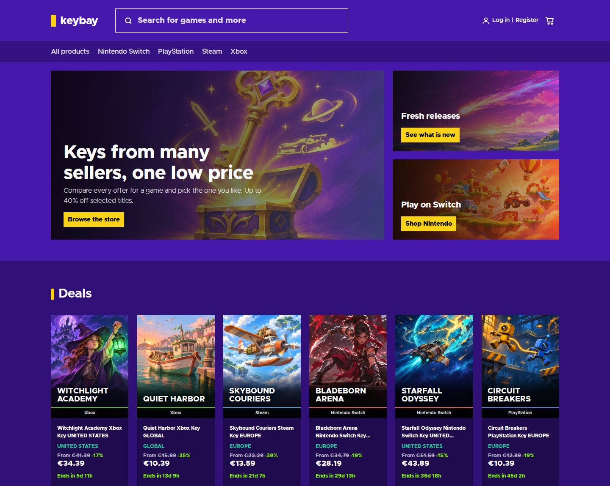
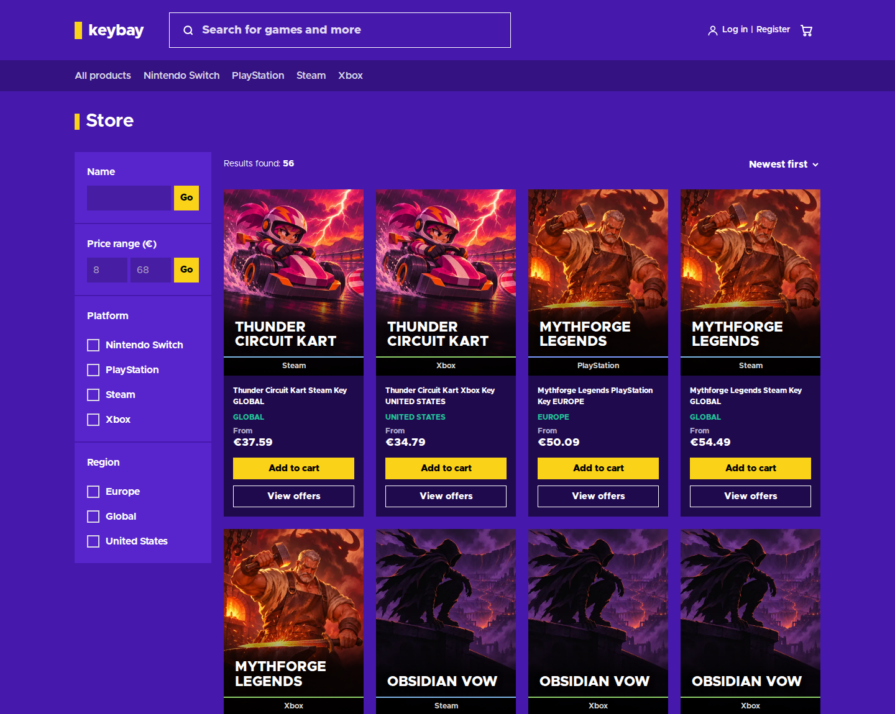
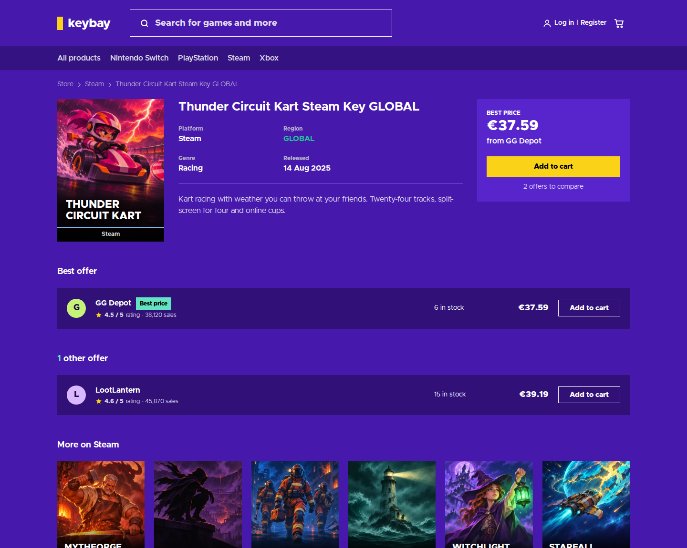

# Keybay: a marketplace for digital game keys

My take-home assignment for the Eneba internship: a marketplace web app in
Eneba's style, where several sellers offer keys for the same game and a buyer
picks an offer, pays and receives the key.

I built it working with an AI coding agent, Claude Code. The whole
conversation, every prompt of mine and every reply, is in
[docs/chat-log.md](docs/chat-log.md), as the brief asks.

React and TypeScript frontend, Go API, PostgreSQL. Not affiliated with Eneba.



| Store | Product page |
|---|---|
|  |  |

## Try it

**Live site:** https://eneba-marketplace-nine.vercel.app

| | |
|---|---|
| Demo login | `demo@keybay.test` / `keybay-demo-2026` |
| Card that pays | `4242 4242 4242 4242` |
| Card that is declined | `4000 0000 0000 0002` |

Payment goes through Stripe in test mode, so no real money moves. On
Stripe's page choose "Card" and use any future expiry date, any three digits
and any name.

A two-minute tour:

1. Type `circut` in the search box. It finds "Circuit Breakers" despite the
   typo.
2. Open a product. Each row is a different seller's offer.
3. Add one to the cart, go to checkout, sign in with the demo login and place
   the order. The order page counts down while your keys are held.
4. Pay with the first card. Back on the order page it says "Confirming your
   payment" for a few seconds, then shows the key.

You can also create your own account with any email. Nothing is sent to it,
so it does not have to be real. An account you create starts with no orders,
while the demo login is shared and shows everyone's test purchases.

## What I built in depth, and where I took shortcuts

The brief says a few features done thoroughly beat many done minimally. I
picked three.

**Checkout and keys.** A key is a row in the database and can be sold once.

- Placing an order reserves its keys in one statement
  (`FOR UPDATE SKIP LOCKED`), so two buyers cannot get the same key.
- A test starts 20 buyers at the same instant against a real database. I
  first ran it against a naive query and watched it fail, to know the test
  can catch the bug.
- An unpaid order expires and its keys go back on sale.
- Stripe confirms a payment by webhook. The request is verified by its
  signature, and a repeated or late message cannot deliver keys twice.
- A payment that arrives after its order expired is refunded automatically.

**Search.** Typo-tolerant search with PostgreSQL's `pg_trgm`, no search
service. Each word typed must match some word of a product name, so
`kart xbox` finds the Xbox edition of "Thunder Circuit Kart". The threshold
was chosen from a table of typos I tested, which is in `DECISIONS.md`.

**Homepage blocks.** The backend decides which blocks the homepage has, in
what order and with what headings. The frontend only knows how to draw each
block type. Reordering the homepage is a database change, not a deploy.

**Shortcuts I took on purpose:**

- **The catalog is invented**: 56 products, with sellers, prices and keys
  made by a seed script. The "best sellers" numbers and the "deals" are seed
  data, not history.
- **The cover and banner art is AI-generated**, with the image generation
  in OpenAI's Codex CLI. [docs/cover-art.md](docs/cover-art.md) has the
  prompt for every image. The title on each cover is written by the page,
  not painted into the picture.
- **Accounts have no email behind them.** Sign-up asks for a name, a
  password typed twice and agreement to the terms, and the server checks
  all of it again. But there is no email service, so no verification and no
  password reset.
- **No seller side and no admin.** Offers and stock come from the seed.
- **Styling follows Eneba's layout and colors**, measured from the site. The
  logo, artwork and other companies' marks are not copied.

## Architecture

```
browser ── React app (static files on Vercel)
              │  REST, JSON, same origin (/api/...)
              ▼
           Go API (one Vercel serverless function)
              │  SQL over a pooled connection
              ▼
           PostgreSQL (Neon)          Stripe ── webhook ──▶ Go API
```

- **One Go router, two entry points.** `backend/httpapi` builds a standard
  `net/http` handler. `api/index.go` runs it on Vercel and `cmd/server` runs
  it as an ordinary server, locally or on any host.
- **Standard library first.** Routing is `net/http`. There is no web
  framework and no ORM: the SQL is written out. The Go dependencies are
  three: `pgx` (PostgreSQL driver), `bcrypt` and `stripe-go`.
- **Packages by subject.** `catalog`, `home`, `auth`, `checkout` and
  `payments` each hold the SQL and rules for one area and know nothing about
  HTTP. `httpapi` turns requests into calls to them.
- **The frontend keeps little state.** Filters, sort and page live in the
  URL. The cart is a list of offer ids in `localStorage`, and prices are
  asked from the server every time. Plain CSS, with design values in one
  file.
- **Sessions are cookies**: a random token in an `HttpOnly`, `Secure`,
  `SameSite=Lax` cookie, with only its hash in the database.
- **Migrations are plain `.sql` files** applied by a small runner in
  `cmd/migrate`.
- **Cover and banner pictures are static files** in `frontend/public`,
  served by Vercel's CDN and cached for a year. A title without a picture
  falls back to a cover the API draws as SVG.

```
api/index.go      entry point on Vercel
cmd/server/       entry point for local runs
cmd/migrate/      applies the .sql files in migrations/
cmd/seed/         fills the database with the invented catalog
migrations/       the database schema, one file per step
backend/          catalog, home, auth, checkout, payments, httpapi
frontend/src/     api, lib, state, components, blocks, pages, styles
docs/             chat log, design reference, art prompts, screenshots
```

## Run it locally

Needs Go 1.27, Node 24 and a PostgreSQL database with the `pg_trgm`
extension available. I used a free Neon database.

```
cp .env.example .env        # then put your connection strings in .env
go run ./cmd/migrate        # create the tables
go run ./cmd/seed           # fill them with the invented catalog
go run ./cmd/server         # API on http://localhost:8080
```

In a second terminal:

```
cd frontend
npm install
npm run dev                 # site on http://localhost:5173
```

Locally, payment is simulated: the order page has a "Pay (test)" button and
a "Simulate a declined card" button, so no Stripe account is needed.
`.env.example` explains the Stripe settings and the others.

## Tests and checks

```
go test -p 1 ./...                  # 86 Go tests
cd frontend && npm test             # 72 frontend unit tests
```

The Go tests that need a database use `DATABASE_URL` from `.env` and expect
the seed data. `-p 1` runs one package at a time, because the packages share
that database.

Every push runs `.github/workflows/ci.yml`: formatting, `go vet`,
`govulncheck`, the migrations and seed on an empty PostgreSQL, the Go tests
with the race detector, then the frontend lint, tests and build.

## Known limitations

**Checkout**

- Expired orders are cleaned up when someone next places or pays an order,
  not by a timer. On a quiet site, stock held by an abandoned order can stay
  held past its deadline until then.
- If someone holds the last key in an unpaid order, others are told it is
  out of stock, although it may come back.
- A buyer cannot cancel an order or ask for a refund. Keys are not emailed.
  There are no invoices and no tax.
- Keys are stored unencrypted.
- Only card payments were tested, though Stripe's page offers other methods.
- On the live demo, stock is topped up automatically after a sale
  (`DEMO_RESTOCK`). The demo login is public, so otherwise anyone could buy
  the store empty.

**Search**

- It does not fix a typo in a word of three letters or fewer, or swapped
  letters in a short word (`krat` for "kart").
- It searches product names only, so `racing` does not find a racing game.
- It scans every product. That is fine for 56 and would need an index and a
  different query for a large catalog.

**Accounts**

- No email verification and no password reset. Both need the site to send
  email, and the project has no email service by choice. So an email here
  proves nothing about who owns it, and a forgotten password means a new
  account.
- The name and the marketing choice can be changed on the account page. The
  email and the password cannot, and an account cannot be deleted.
- The marketing checkbox stores a choice. Nothing is ever sent.
- The Terms and Privacy pages are demo text, and say so.
- Signing up with a registered email says so, which reveals that the account
  exists.
- The demo account is shared. Anyone who uses it sees its orders and keys.

**Everything else**

- The API runs as a serverless function, so the first request after a quiet
  period is slower.
- The cart lives in one browser and does not follow you to another device.
- A deal's price does not go back up when the deal ends, and the deals block
  empties over about 60 days from the last seed.
- The browser checks I ran (pages, purchase, Stripe) were scripted by hand
  in Chromium. They are not part of CI, and I did not test other browsers or
  a screen reader.
- The art was checked by eye for text, logos and likeness to existing
  games, and nine images were redone. That check cannot rule out a likeness
  to work I do not know.
- English and euros only.

## More

- [PLAN.md](PLAN.md): scope, data model and API, written before building.
- [DECISIONS.md](DECISIONS.md): 92 numbered choices, each with its
  alternatives and the reason. Start here for "why did you do it this way".
- [docs/chat-log.md](docs/chat-log.md): the full AI chat history, as the
  brief asks.
- [docs/design-reference.md](docs/design-reference.md): the colors and sizes
  measured from eneba.com.
- [docs/cover-art.md](docs/cover-art.md): how each cover and banner was
  generated.
- [docs/screenshots/](docs/screenshots/): the site at each phase.
